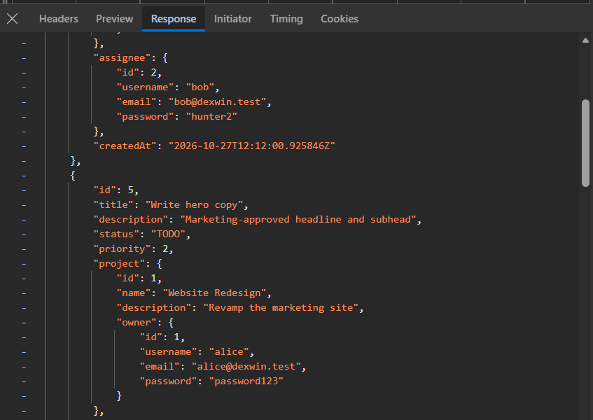
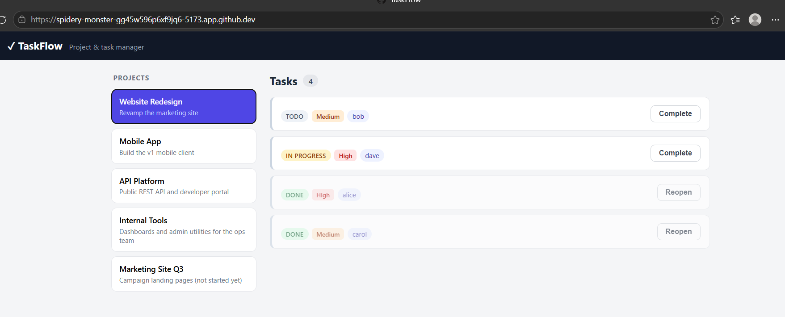
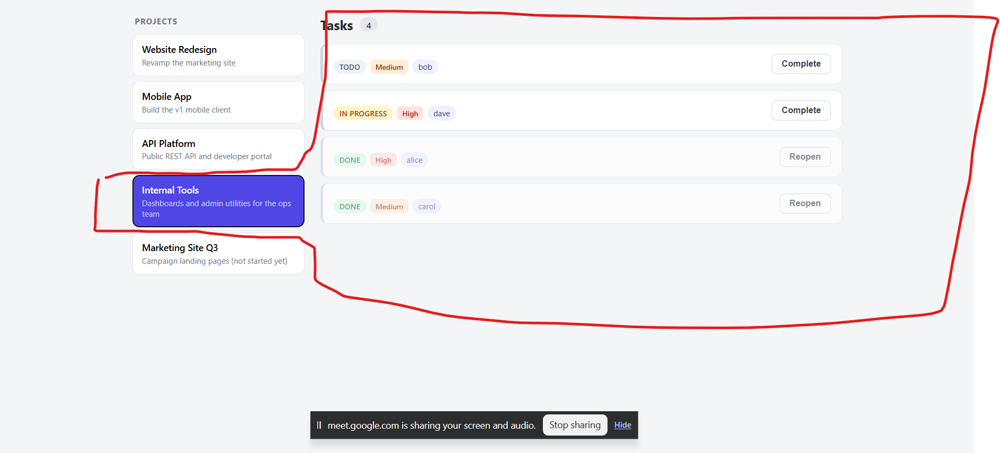
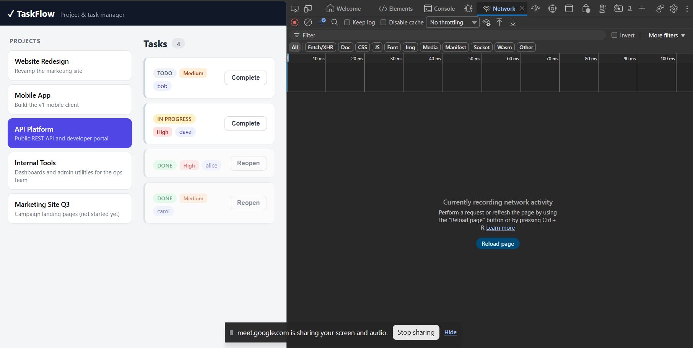

BUG O1: User Passwords are returned by the projects and task API'S

Status: confirmed
Severity: Higer/Blocker(exposes user credentials)

Steps to reproduce
1. Open the local link or url (http://localhost:5173) with devtools
2. Identify the network tab and open it
3. Click on any project 
4. Inspect the responses for the /api/projects and id 

Expected condition : The user objects contain only public fields (id, username)

Actual condition: User objects include password 

Evidence

BUG 002
Login returns 200 for wrong passwords and 500 for unknown users 

Status: confirmed 

Severity : Higer 

Steps to reproduce 

POST /api/auth/login {"username,":"alice", "password":"incorrect"}

Expected: Both return 401 with the same generic message.

Actual result : 200 with authenticated: false and user id 500

Bug 03
Task titles are blank in the UI

Status: confirmed

Severity: Higher

steps to reproduce 
Open the app 
click on any project "website redesign"
Observe to see if title renders

Expected result: Each card shows its title 

Actual result: Title area is empty but the API field is having title

Evidence 

BUG 04
Switching projects keeps showing the same or first project's tasks

Status : confirmed

Severity Higher 

Steps to reproduce
Click on first project Website Redesign and observe the tasks
Select the second project "Mobile App" and observe the tasks

Expected result: Borad shows Mobile App tasks(4 tasks)

Actual Result: Board stil shows Website Redesign 

Evidence 

BUG 05
Complete or reopen does not update the screen

Status: confirmed

Severity: Higher

Priority : P1

Steps to reproduce 
open a project and click complete on a todo task then refresh the page

expected result : card immediateley shows done and the button changes to reopen

actual result : no visible change.